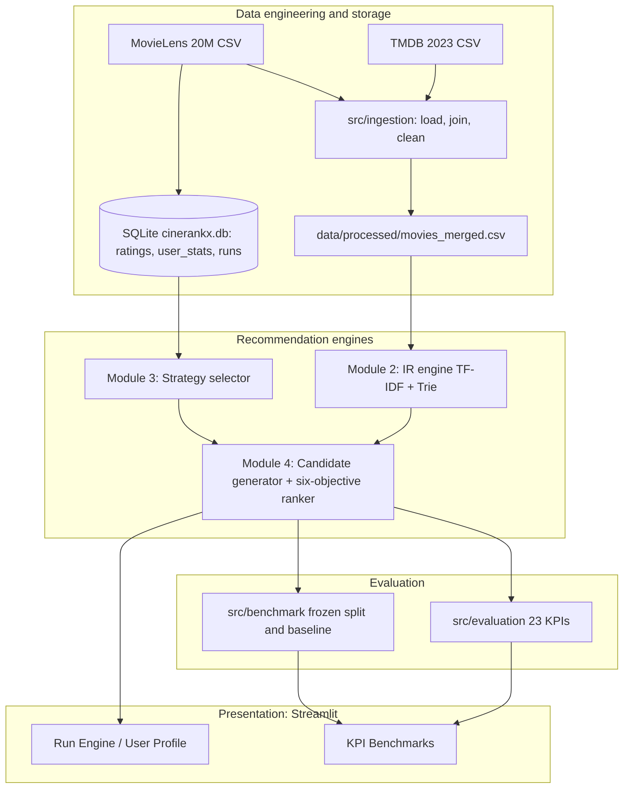
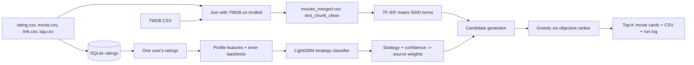

# Chapter 2. Problem Statement and Motivation

## 2.1 The general problem: too many movies, too little attention

A streaming catalog can contain tens of thousands of titles. The MovieLens catalog used here has 27,278 movies; the TMDB export we joined has about 1.5 million. A user cannot browse that. A **recommender system** is software that selects a short list of items the user is likely to value. The difficulty is that "likely to value" is not directly observable. We only observe indirect evidence: ratings, tags, what other users rated, and item descriptions.

## 2.2 How conventional recommenders work, and where each one fails

| Approach | Idea | Typical weakness (and what it means for CineRankX) |
|---|---|---|
| **Popularity-based** | Recommend what most people rated | Not personalised; reinforces *popularity bias* (the rich get richer); but surprisingly strong on offline accuracy, which is why it is our fallback and our frozen baseline |
| **Collaborative filtering (CF)** | "Users like you liked X" | **Cold start** (new users/items have no history); the user-item matrix is extremely sparse (MovieLens 20M: 20M ratings among 138,493 x 27,278 = 3.8 billion possible pairs, about 0.53% filled) |
| **Content-based filtering** | "X is similar to what you liked" using item text/metadata | Over-specialisation (always similar items); depends on metadata quality; in our data it is the weakest individual strategy (hit-rate 0.016) |
| **Hybrid** | Combine several of the above | Usually one *fixed* blend for everybody |
| **Single-objective ranking** | Sort by one score | The top of the list is often ten near-duplicates; no notion of diversity, novelty or coverage |

## 2.3 Why one strategy cannot suit every user

Different users give the different methods different amounts of evidence:

* A user with 5 ratings gives collaborative filtering almost nothing to work with, but popularity needs no history.
* A user whose ratings cluster in one genre gives content-based filtering a clear profile; a user who rates everything gives it a blurry one.
* A user whose taste matches a large neighbourhood benefits from CF; an idiosyncratic user does not.

CineRankX's data confirms this is not just theory. Over 4,993 sampled users the best strategy on a hidden holdout was popularity for 64% of users, collaborative for 33% and content-based for 2% (Chapter 9). The mix differs per user, which is exactly what a per-user strategy selector tries to exploit.

## 2.4 Why single-objective ranking is not enough

If we rank only by relevance, the top ten for a *Toy Story* fan are nine animated sequels. A good list also needs:

* **Diversity**: items should not be near-copies of each other.
* **Novelty**: some items the user is unlikely to already know.
* **Coverage**: across all users, the system should not only ever show the same few titles.
* **Quality / popularity**: well-regarded items are safer bets.
* **Predicted rating**: how much we expect this specific user to like it.

These objectives conflict. Raising diversity lowers average relevance (the project measured diversity 0.952 -> 0.972 at the price of relevance 0.814 -> 0.657 when diversity weight was raised from 0.15 to 0.60). The weights therefore expose the trade-off.

## 2.5 Formal problem statement

> **Given** a user *u* with an observed rating history *R_u* (possibly very short), a movie catalog *M* with text and metadata, and a population of other users' ratings, **select** a strategy *s(u)* from {content-based, collaborative, popularity} predicted to perform best for *u*, **generate** candidate movies from the strategies weighted by that prediction, and **rank** them on six weighted objectives (relevance, diversity, novelty, coverage, popularity/quality, predicted rating) to produce a top-K list that is accurate on held-out interactions while remaining diverse, novel and explainable.

## 2.6 Objectives, scope and research gap

**Objectives** (from the README and the code):

1. Build a classical IR engine (TF-IDF + Trie) over movie text.
2. Learn a per-user strategy selector from backtested strategy performance.
3. Re-rank candidates on six tunable objectives.
4. Evaluate everything with a fixed set of 23 named KPIs.
5. Provide an interactive application for inspection (later work).

**Scope:** offline evaluation on MovieLens 20M with TMDB enrichment; explainable classical machine learning; no deep learning; no live user feedback.

**Research gap addressed:** most hybrid recommenders blend strategies with one global weighting, and most re-rankers optimise one or two objectives. CineRankX studies (a) *user-specific* strategy choice and (b) a six-objective re-ranker in one pipeline, and, importantly, measures honestly how reliable the strategy labels are. This is a combination of established techniques, not a claim of a brand-new algorithm (Chapter 13).

## 2.7 Expected versus achieved outcomes

| Expected (from README/CLAUDE.md) | Achieved (verified) |
|---|---|
| Classifier that predicts best strategy per user | Built; deployed LightGBM has accuracy 0.617, macro-F1 0.472, ROC-AUC 0.735; it does *not* beat the majority class on accuracy but does beat it on balanced accuracy (0.469 vs 0.333 chance) and recommendation value |
| Ranking on six objectives with tunable weights | Built and tested (72 ranking tests); weights in `eval_config.yaml` |
| 23-KPI evaluation suite | Built; `scripts/generate_kpi_report.py` writes `reports/kpi_report.json` |
| Diverse, relevant, explainable lists | Diversity 0.837, MAP 0.114 in the KPI report; every result card shows a score breakdown and reason |
| (Later) accurate recommendations versus a fixed baseline | Hit Rate@10 0.877 vs 0.601 frozen baseline on the benchmark |
| (Implicit hope) high classifier accuracy | **Not achieved** (label noise ceiling about 0.76, Chapter 9) |

# Chapter 3. Complete Project Overview

## 3.1 What CineRankX does, in plain words

Open the web app, enter a MovieLens user ID, choose how many movies you want and how much you care about each of the six objectives, and press **Generate recommendations**. CineRankX:

1. looks at that user's rating history,
2. computes a feature vector describing the user,
3. asks a trained classifier which strategy suits them (and how confident it is),
4. pulls candidate movies from three sources, weighting the sources by that prediction,
5. re-ranks the candidates greedily on the six objectives, and
6. shows ranked movie cards with a score breakdown, lets you export a CSV, and records the run in a database.

## 3.2 The user journey in the application

| Step | Screen | What happens |
|---|---|---|
| 1 | Top navigation | Five sections: Overview, Recommendation Engines, Run Engine, User Profile, KPI Benchmarks; the URL keeps the section (`?view=run`) |
| 2 | Overview | Catalog size, ratings in sample, strategy model status, search MRR; candidate funnel; objective weights; strategy routing; telemetry; surfaced candidates |
| 3 | Recommendation Engines | Three cards describing the IR engine, the strategy selector and the ranker, with real metrics from the saved report |
| 4 | Run Engine | Choose "Live engine" or "Upload ranked CSV"; set user ID, K and the six weights; press Generate; see movie cards and export CSV |
| 5 | User Profile | A 360-degree view: summary, paginated rating history, genre/decade/language preferences, past recommendation runs, current recommendations |
| 6 | KPI Benchmarks | Classification quality, the strategy comparison (frozen baseline vs CineRankX), top-K charts, system performance |

## 3.3 The three engines and how they cooperate

* **Engine 1: IR engine** (`src/ir_engine`). Builds a TF-IDF vector for every movie and answers "which movies are most similar to this text or this movie?". A Trie provides instant title autocomplete.
* **Engine 2: Strategy selector** (`src/strategy_selector`). Turns a user's history into features and predicts which of three strategies fits best, with a confidence.
* **Engine 3: Ranking engine** (`src/ranking_engine`). Builds a candidate pool from IR similarity, collaborative filtering and popularity, then selects the final list one movie at a time using six objectives.

An **evaluation suite** (`src/evaluation`) and a **benchmark package** (`src/benchmark`) measure the whole thing, and a **UI layer** (`app.py`, `src/ui`) presents it.

## 3.4 Strategy selection versus hybrid blending (what is actually implemented)

This distinction is a common viva trap, so be precise:

| Term | Meaning | In CineRankX |
|---|---|---|
| **Strategy selection** | Pick *one* strategy for a user | The classifier predicts a strategy and a confidence |
| **Strategy switching** | Change the strategy at run time by a rule | Not used as a hard switch |
| **Weighted score combination (hybrid)** | Blend several strategies' scores | **Yes**: `strategy_source_weights(strategy, confidence)` turns the prediction into blending weights over the three sources |
| **Hybrid ranking** | Combine objectives | **Yes**: six weighted objectives in the ranker |

So the predicted strategy is a **weighted prior**, not a hard route: at chance confidence (1/3) the blend equals a fixed prior (collaborative 0.60, content 0.20, popularity 0.20); at confidence 1.0 it is fully the predicted strategy; in between it interpolates linearly.

## 3.5 System architecture

**Component explanations**

* *Data layer*: raw CSVs stay in `newdata/` (git-ignored); `src/ingestion` produces `movies_merged.csv`; `scripts/build_user_db.py` streams the 20M ratings into SQLite so a single user's history can be read quickly.
* *Engines*: the three modules are separate packages with their own tests.
* *Evaluation*: two complementary systems. `src/evaluation` is the original 23-KPI suite; `src/benchmark` is a stricter, frozen, hash-split benchmark used for the baseline comparison.
* *Presentation*: `app.py` is the Streamlit entry point and router; `src/ui/*` holds the screens.

## 3.6 End-to-end data flow

Read it as two phases. **Offline** (done once, or when data changes): ingestion, TF-IDF fitting, labelling users, training the classifier. **Online** (per request): load that user's ratings, build features, predict strategy, generate candidates, rank, display.
